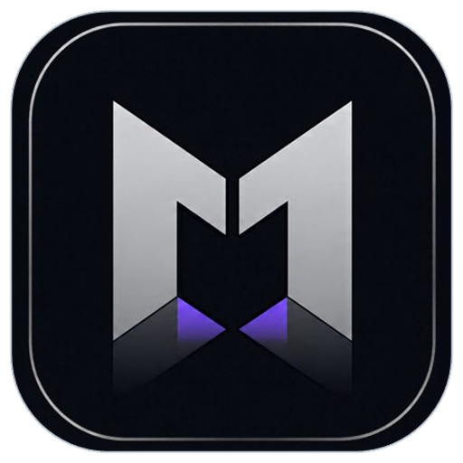
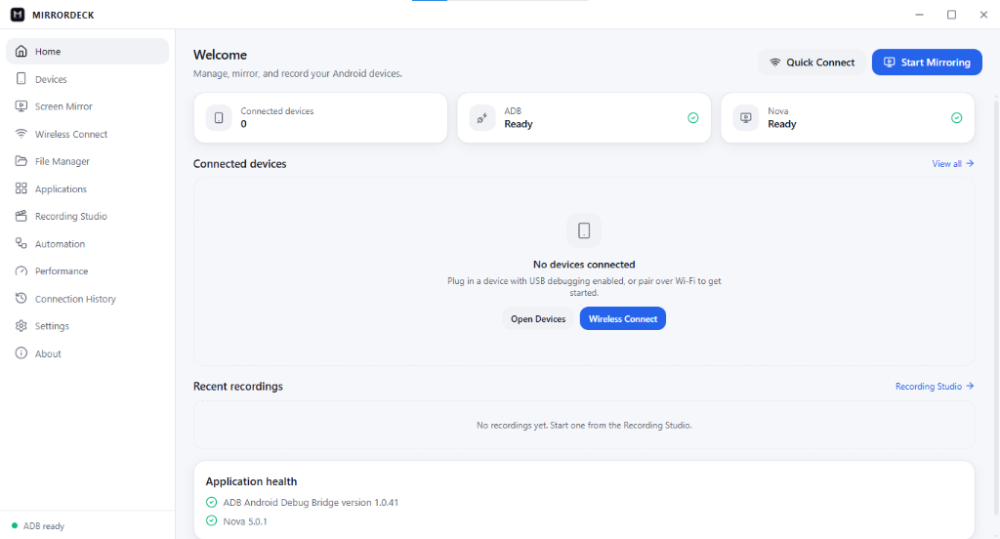
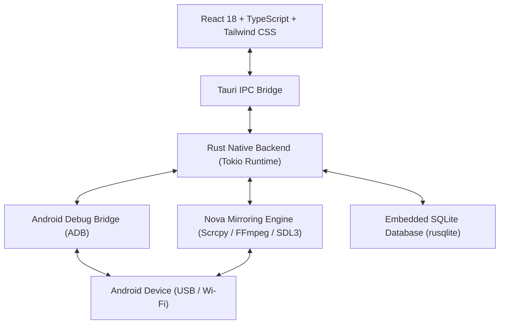

<div align="center">



# MirrorDeck

**Premium Android Device Management & Ultra-Low Latency Screen Mirroring Desktop Application**

[](https://tauri.app/)
[](https://react.dev/)
[](https://www.typescriptlang.org/)
[](https://www.rust-lang.org/)
[](https://github.com/kiturecoverd-a11y/MirrorDeck)
[](https://github.com/kiturecoverd-a11y)
[](LICENSE)

<br />



</div>

---

## 🌟 Overview

**MirrorDeck** is a modern, high-performance desktop application designed for power users, developers, and mobile gamers who need seamless Android management and buttery-smooth screen mirroring.

Built from the ground up with **Tauri v2** and **React**, MirrorDeck combines a lightweight Rust native core with a clean frameless glassmorphic interface, delivering near-zero latency, robust wireless connectivity, and complete device control without terminal clutter.

---

## ⚡ Key Features

- **🚀 Ultra-Low Latency Screen Mirroring**
  - Powered by the high-performance **Nova** mirror engine.
  - Hardware-accelerated H.264/H.265 video decoding with customizable bitrates (up to 32 Mbps), frame rates (up to 120 FPS), and display resolutions.
  - Real-time keyboard, mouse, and shortcut forwarding with minimal CPU and memory overhead.

- **📶 Wireless & USB Device Management**
  - Instant plug-and-play USB auto-detection via bundled ADB.
  - One-click **Wireless Pair & Connect** (ADB over Wi-Fi / TCP/IP) without needing a USB cable after initial pairing.
  - Multi-device monitoring, alias customization, and persistent connection history.

- **📁 Interactive Device File Explorer**
  - Full-featured visual filesystem browser for internal and SD card storage.
  - Fast file operations: upload (push), download (pull), create folders, and delete files with live progress indicators.

- **📦 Application & Package Manager**
  - View all installed third-party, system, and disabled packages with one click.
  - Drag-and-drop APK installation directly into the window.
  - Quick launch and clean package uninstall tools.

- **🎥 Built-in Recording Studio**
  - High-bitrate screen recording saved directly to MP4.
  - Instant screenshot captures with automatic desktop saving.

- **🎨 Modern Frameless UI & Theming**
  - Custom drag-and-snap frameless title bar with native minimize, maximize, and close controls.
  - Full **Light Mode** and **Dark Mode** support with adaptive brand typography and icons.

---

## 🏗️ Architecture & Tech Stack



| Layer | Technologies |
| :--- | :--- |
| **Frontend** | React 18, TypeScript, Vite, Tailwind CSS, Framer Motion, Zustand, Lucide Icons |
| **Desktop Shell** | Tauri v2, WebView2, Custom Frameless Window Subsystem |
| **Native Backend** | Rust (2021 edition), Tokio, rusqlite, sysinfo, rfd |
| **Drivers & Core** | Android Debug Bridge (ADB v1.0.41), Nova Mirror Engine |

---

## 🚀 Getting Started

### Prerequisites

Ensure you have the following installed on your development machine:

1. **Node.js**: `v18.0.0` or newer ([Download Node.js](https://nodejs.org/))
2. **Rust**: `v1.77.0` or newer ([Install Rust via rustup](https://rustup.rs/))
3. **C++ Build Tools**: Visual Studio Build Tools (C++ workload) or MSVC v143+
4. **Android Device**: With **Developer Options** and **USB Debugging** enabled.

### Installation

1. **Clone the repository:**
   ```bash
   git clone https://github.com/kiturecoverd-a11y/MirrorDeck.git
   cd MirrorDeck
   ```

2. **Install frontend dependencies:**
   ```bash
   npm install
   ```

3. **Bootstrap core runtime dependencies (ADB & Nova Engine):**
   ```powershell
   powershell -ExecutionPolicy Bypass -File scripts/bootstrap.ps1
   ```

4. **Launch development environment:**
   ```bash
   npm run tauri dev
   ```

5. **Build standalone release:**
   ```bash
   npm run build
   cd src-tauri
   cargo build --release
   ```
   The compiled standalone executable will be located in `src-tauri/target/release/mirrordeck.exe`.

---

## 📁 Repository Structure

```
MirrorDeck/
├── docs/                   # Documentation and architectural decisions
│   ├── images/             # Official branding and UI screenshots
│   │   ├── logo.png        # Official 3D squircle logo
│   │   ├── logo_light.png  # Vector light mode emblem
│   │   ├── logo_dark.png   # Vector dark mode emblem
│   │   └── screenshot.png  # Dashboard screenshot
│   └── architecture/       # ADRs and design notes
├── public/                 # Static assets and favicon
├── scripts/                # Setup and dependency bootstrap automation
├── src/                    # Frontend React application
│   ├── assets/             # Bundled logos and vector marks
│   ├── components/         # Reusable UI components & layouts
│   ├── lib/                # Zustand store, Tauri API bridge, theme handlers
│   ├── pages/              # Views (Home, Devices, Mirror, Files, Apps, etc.)
│   └── styles/             # Tailwind & CSS design system
├── src-tauri/              # Rust native backend
│   ├── icons/              # Multi-resolution ICO and Windows PNG icons
│   ├── src/                # Rust commands, ADB controller, process handlers
│   ├── Cargo.toml          # Rust dependencies & optimization profiles
│   └── tauri.conf.json     # Tauri app configuration & permissions
├── index.html              # Frontend entrypoint
├── package.json            # Node.js dependencies and build scripts
├── tailwind.config.js      # Design tokens and theme styling
├── tsconfig.json           # TypeScript configuration
└── vite.config.ts          # Vite build bundler configuration
```

---

## 👨‍💻 Developer & Author

- **Developer**: **Kitub**
- **GitHub**: [@kiturecoverd-a11y](https://github.com/kiturecoverd-a11y)
- **Repository**: [https://github.com/kiturecoverd-a11y/MirrorDeck](https://github.com/kiturecoverd-a11y/MirrorDeck)

---

## 📄 License

This project is licensed under the **MIT License** — see the [LICENSE](LICENSE) file for details.

### Third-Party Credits
- **Nova Engine / Scrcpy**: [Genymobile/scrcpy](https://github.com/Genymobile/scrcpy) (Apache License 2.0).
- **Android Platform Tools**: Google LLC (Android Open Source Project).
